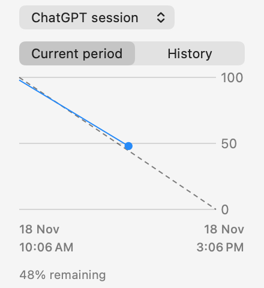

# SwiftBar AI Usage

ChatGPT, Claude, and Amp usage remaining in one macOS menu-bar item, with reset countdowns and a compact native Swift Charts history graph inside the dropdown.

**Source release. Requires the patched SwiftBar build included here. Stock SwiftBar does not support the `nativechart` and `textonly` parameters.** This is an independent project, not an official integration from any provider or the SwiftBar project. No signed/notarized app download is provided.



The preview uses invented readings, rendered by the actual native chart. It is not a screenshot of an open SwiftBar menu.

## What it shows

- One menu-bar line with full provider names, remaining percentages, and reset countdowns.
- Every recognized usage window returned by each source; absent windows are not invented.
- Readable, non-selectable information rows and clickable provider headings.
- A 220 × 240-point native remaining-usage chart with a solid observed line, dashed ideal pace, latest-reading dot, and no hover readout. Choose a limit and switch between its current period and retained history.
- Refresh on opening, without blocking the menu, plus a one-minute timer. Claude network requests run at most every five minutes when healthy; rate limiting increases the delay and honors `Retry-After`.
- Explicitly labeled cached readings during failures. Only successful observations enter the history.

## Requirements

- macOS 13 or newer for Swift Charts. Tested on macOS 27.2 with Xcode 27.2; earlier supported versions have not been verified.
- Full Xcode (not just Command Line Tools), Git, `jq`, `curl`, and SQLite with JSON output/window functions. macOS supplies the latter two; `brew install jq` supplies jq.
- A local login for each enabled provider:
  - **ChatGPT:** Codex CLI signed in using a ChatGPT account (`codex login`), with tokens in `${CODEX_HOME:-~/.codex}/auth.json`.
  - **Claude:** Claude Code signed in, with OAuth credentials in the macOS Keychain service `Claude Code-credentials`. macOS may ask to allow access.
  - **Amp:** the `amp` CLI installed and signed in; `amp usage` must work.

API-key-only accounts and alternative credential storage formats are not supported. The plugin reads credentials; it never refreshes or exports them. Sign in again using the respective CLI when authentication expires.

## Build and install

Review the scripts before running them. Do not use `sudo`.

```sh
git clone https://github.com/markosnarinian/swiftbar-ai-usage.git
cd swiftbar-ai-usage
bash native/build.sh
bash install.sh
```

The build script fetches the exact upstream revision recorded in `native/upstream-revision`, applies `native/swiftbar.patch`, runs the SwiftBar tests, and ad-hoc signs a local Debug build. The upstream license is retained in `native/LICENSE-SwiftBar`. The build requires network access to GitHub and Swift package dependencies.

Quit any running SwiftBar instance. To keep stock SwiftBar untouched, copy the built app under a different name and open it:

```sh
mkdir -p "$HOME/Applications"
ditto .build/DerivedData/Build/Products/Debug/SwiftBar.app "$HOME/Applications/SwiftBar AI Usage.app"
open "$HOME/Applications/SwiftBar AI Usage.app"
```

Choose `~/.swiftbar` as the plugin directory when prompted. To use an existing directory instead, run `bash install.sh "/path/to/plugins"` and select that same directory in SwiftBar.

The custom app retains upstream SwiftBar's bundle identifier and shares its preferences. **Run only one copy, and disable automatic upstream updates for this custom build:** installing an upstream update removes native chart support. The installer does not replace your application, change login items, or edit other plugins.

## Configuration and removal

The installer preserves existing configuration. New installations enable all three providers in `~/.config/swiftbar-usage/config`:

```sh
SERVICES="codex claude amp"
```

Remove provider identifiers to disable them. `codex` is the internal identifier for **ChatGPT**, retained for credential and history compatibility. The config is sourced as Bash: treat it as executable code, not untrusted input. The UI remains combined; there is no separate-layout mode.

```sh
bash uninstall.sh
# Or: bash uninstall.sh "/path/to/plugins"
```

Uninstall removes the entrypoint and runtime scripts, but preserves configuration, cached readings, history, credentials, and the app. Stop/remove the plugin before manually deleting `~/.cache/swiftbar-usage` if you also want to erase its history.

## Data sources, privacy, and limitations

| Display name | Source | Scope |
| --- | --- | --- |
| ChatGPT | `chatgpt.com/backend-api/wham/usage`, authenticated with the local Codex login | The Codex-related subscription windows this endpoint reports, **not all ChatGPT chat/model limits** |
| Claude | `api.anthropic.com/api/oauth/usage`, authenticated with the local Claude Code login | Recognized five-hour, weekly, and model-specific weekly windows |
| Amp | `amp usage` CLI output | Reported agent/orb allowances and individual/workspace credit balances |

These interfaces and CLI output formats may change without notice. Claude HTTP 429 means the **usage check** was throttled, not necessarily that your allowance is exhausted. The plugin retains known readings as cached and retries later. A first-run failure has no previous reading to show.

Amp's renewal date has no exact time; its countdown is approximate and prefixed with `~`. A reset marked `due` is not evidence that a new allowance has been fetched.

Data stays in `~/.cache/swiftbar-usage` (SQLite history plus normalized responses and retry state). Provider response bodies are temporarily written there during collection; credential headers are passed to curl over stdin rather than command arguments or cache files. Files created by the collector use a restrictive umask. Requests go to the providers; there is no added analytics or upload service. Do not attach your real cache, auth files, or unredacted screenshots to issues.

History retains 90 days of observed samples. The chart defaults to the selected limit's current reset period, with an ideal pace from 100% at the period start to 0% at reset. The History tab shows its full retained history without an ideal-pace line. If reset timing is unavailable or expired, the chart falls back to recorded history without inventing a reset. Points keep isolated observations visible; gaps and resets break lines rather than interpolating invented usage. Dense data is reduced to per-bucket extrema for display. It starts empty unless you import existing observations (below); it cannot reconstruct unrecorded usage. With many enabled limits, the combined menu-bar title can exceed available screen space; the dropdown keeps its own compact width.

### Import earlier ChatGPT observations

If your local Codex session logs contain rate-limit observations, you can backfill the graph without making network requests. This optional command requires Python 3.9 or newer:

```sh
python3 import_codex_history.py
```

It reads only `token_count` rate-limit events from `sessions` and `archived_sessions` under `CODEX_HOME` (default `~/.codex`), imports observations within the 90-day retention period, ignores other named model limits, and preserves existing database samples. No conversation content is stored or uploaded. Re-running is safe. Missing observations stay missing. If you have switched accounts in this Codex profile, its older logs may belong to a different account; use `--codex-home` to select the appropriate profile. `--database` can target a separate SQLite file for inspection first.

CodexBar may have recorded additional quota observations independently of the CLI logs. To import its supported account-scoped history too:

```sh
python3 import_codex_history.py --codexbar-history "$HOME/Library/Application Support/com.steipete.codexbar/history/codex.json"
```

This reads only the bucket matching the current `tokens.account_id` in Codex's `auth.json`. Other accounts and unscoped history are not imported. It converts recorded percent-used to percent-remaining; it does not import estimated token costs as quota readings, change CodexBar's files, or upload history.

## Development and checks

```sh
bash plugin/test.sh
python3 tests/test_import.py
bash native/build.sh
```

The plugin checks use a disposable home, synthetic responses, and mocked HTTP/Keychain commands: no real credentials or provider requests. They cover normalization, ChatGPT labels (including legacy caches), reset/gap segmentation, retention, rate-limit backoff, Retry-After seconds/dates, and recovery. The native patch includes an integration test for the chart, wrapping text rows, and transitions back to ordinary menu items.

The public repository contains source and synthetic preview assets only. MIT licensed; upstream SwiftBar portions retain their original copyright and MIT terms.
